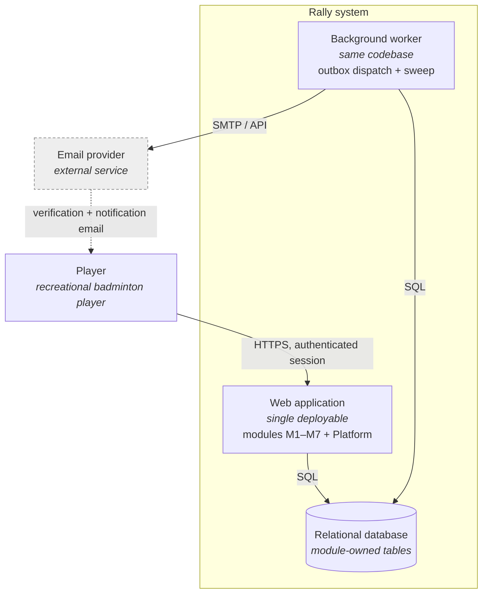
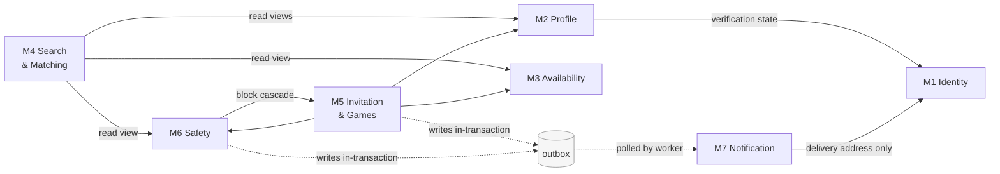
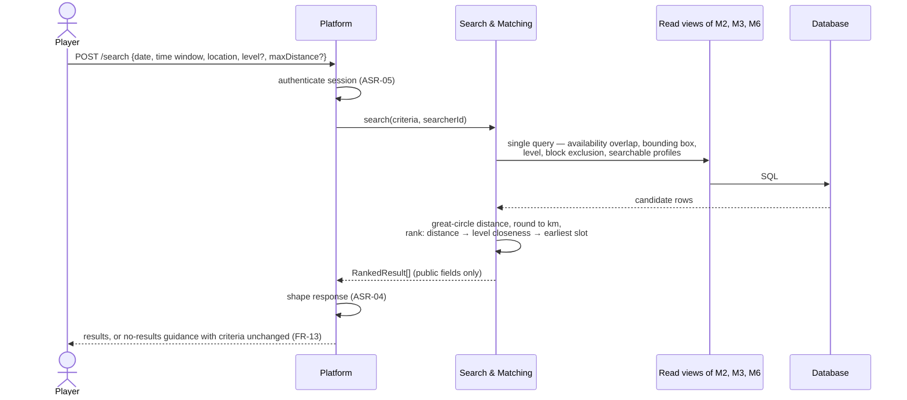
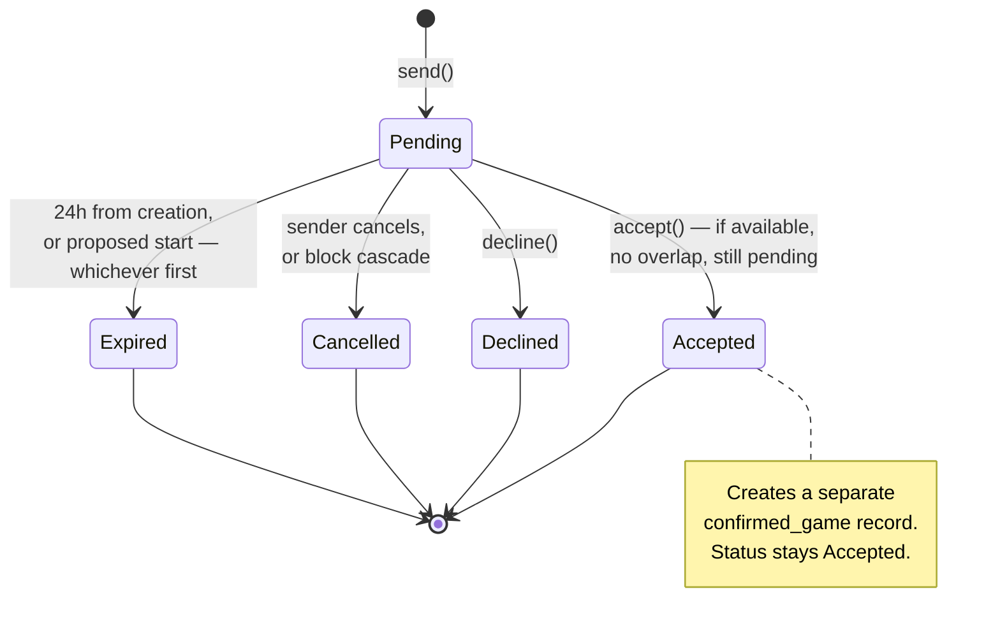
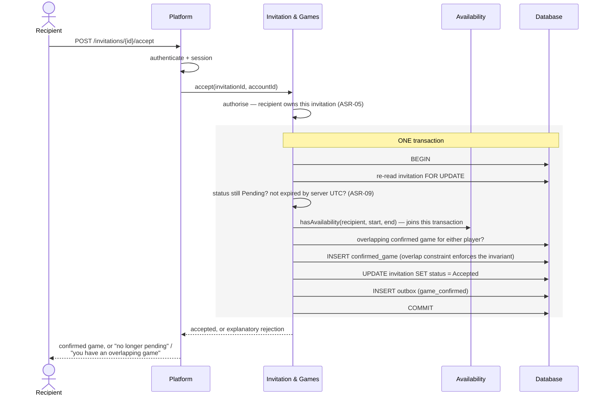
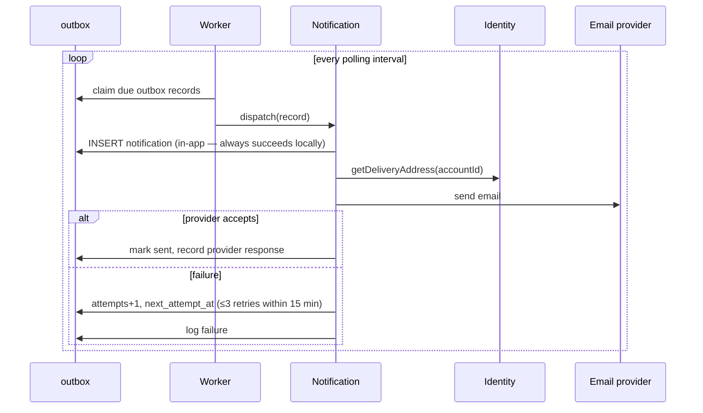
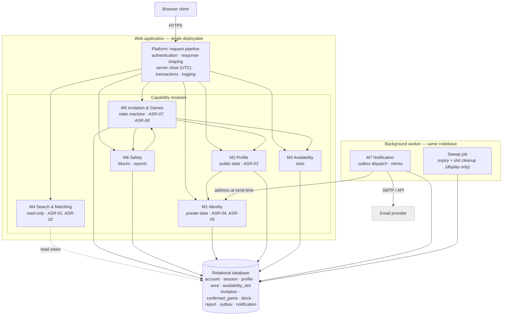
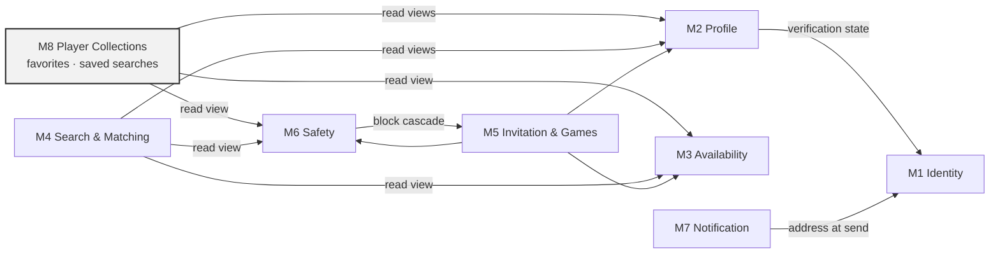
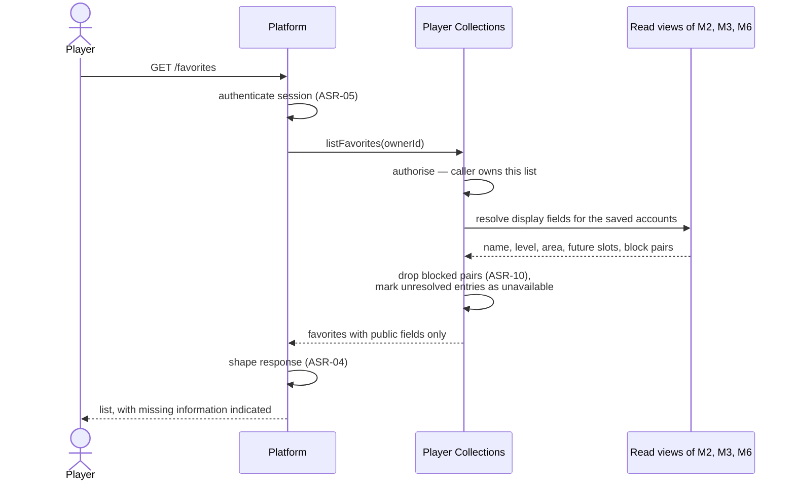

# Rally — Software Architecture

**Project:** Rally — recreational badminton partner finding
**Deliverable:** D3 — Architectural context for AI-assisted development
**Authors:** Awais (architecture lead), Fazeel (ADRs), Ali Tahir (agent context)
**Source of requirements:** Final Validated PRD (Rally)
**Supporting documents:** `ASR-analysis.md`, `architecture-alternatives.md`, `architecture-decisions.md`, `adr/`
**Status:** Baseline for implementation · **Date:** 2026-11-09
**Amendment 1 (2026-11-11):** three further requirements received — FR-16, FR-17, FR-18. Recorded in **§16**. Sections 1–15 are the unchanged baseline.

---

## 1. System overview

### 1.1 Purpose

Rally helps recreational badminton players find a suitable playing partner when their usual friends are unavailable. A player describes when and where they want to play; Rally returns other players whose availability, general area and playing level match, and lets the player send an invitation for a specific date, time and venue. The recipient accepts or declines; acceptance creates a confirmed game.

The PRD is explicit that Rally is a *proposed* response to a documented coordination problem, not a proven improvement over WhatsApp (PRD §2). The architecture is sized accordingly: small, verifiable, and cheap to change.

### 1.2 What the system does

Five capabilities, which are also the module boundaries (§5):

1. Maintain a player identity, profile and availability.
2. Search for and rank suitable partners.
3. Invite a player, respond, and confirm or cancel a game.
4. Notify both players of outcomes.
5. Block and report players.

### 1.3 What the system deliberately does not do

Court booking, payment processing, in-app chat, player ratings or reviews, attendance tracking (PRD §5.2, §12.5); rescheduling (§12.4); recurring availability schedules (§12.1); player-controlled privacy settings (§12.2). None of these appear anywhere in the architecture. Their absence is why the system has exactly one external dependency.

### 1.4 Shape of the system

A single web application, one relational database, and one background worker built from the same codebase. One external service: an email provider.



Note that the web application never contacts the email provider directly — only the worker does. That separation is what makes the reliability exclusion in NFR-04 structurally true (§3, ASR-12).

---

## 2. Architectural goals and drivers

Full derivation in `ASR-analysis.md` §2. Summarised here because the rest of this document is justified against it.

### 2.1 Functional drivers

| ID | Driver | PRD ref | Structural demand |
| --- | --- | --- | --- |
| DR-F1 | Find a suitable partner | FR-02, FR-03, FR-05, FR-07 | The hot read path; one owner for the matching predicate and ranking |
| DR-F2 | Arrange a game | FR-08, FR-09, FR-11, FR-15 | The only multi-actor stateful workflow; defines the main transaction boundary |
| DR-F3 | Maintain identity and availability | FR-01, FR-04, §12.1, §12.2 | Owns the data every other capability reads |
| DR-F4 | Keep both players informed | FR-10, FR-12 | The only capability reaching an external service |
| DR-F5 | Stay safe — block and report | §12.5 | A cross-cutting rule altering DR-F1 and DR-F2 |

### 2.2 Quality attribute drivers

| ID | Attribute | Measurable scenario | PRD ref |
| --- | --- | --- | --- |
| QA-01 | Performance | 100 concurrent players search a 10,000-profile dataset; results in ≤2 s for ≥95% of requests | NFR-01, §12.6 |
| QA-02 | Confidentiality | No client — authenticated, unauthenticated or direct — obtains another player's email, phone or exact location, including after acceptance; 100% of privacy tests pass | NFR-03, FR-14, §12.2 |
| QA-03 | Concurrency correctness | Simultaneous actions on one invitation, or simultaneous accepts of overlapping invitations, leave exactly one committed; zero overlapping confirmed games | FR-15, §12.3, §12.4 |
| QA-04 | Reliability | ≥99.5% of valid profile, search and invitation operations succeed over 30 days, excluding email-provider outages | NFR-04, §12.6 |
| QA-05 | Usability | ≥90% of test users complete the find-a-player task unassisted in ≤2 minutes | NFR-02, §12.6 |
| QA-06 | Modifiability *(project context)* | A change stays inside one module and its interface; no new cross-module dependency, framework or service without approval | D3 brief |

### 2.3 Priority

| Priority | Drivers | Consequence |
| --- | --- | --- |
| Non-negotiable | QA-02, QA-03, DR-F2 | A single transactional core with a single privacy enforcement point |
| High | QA-01, DR-F1, DR-F3 | Matching must be one query; shared data has clear owners |
| Shaping | QA-04, DR-F4, DR-F5, QA-06 | Asynchrony and failure isolation; few, clearly named modules |
| Bounded | QA-05 | Response composition only |

The decisive tension: **QA-02, QA-03 and DR-F2 all pull toward one transactional core, while QA-04 is the only driver pulling work out of the request path.** The architecture resolves it with a single deployable plus an in-process outbox and worker — asynchrony without distribution.

---

## 3. Architecture Significant Requirements

Thirteen ASRs. Full register with per-clause sourcing in `ASR-analysis.md` §3 and §7. The final column is what matters here: how *this* architecture answers each one.

### 3.1 Performance

| ID | ASR | Source | Architectural response |
| --- | --- | --- | --- |
| **ASR-01** | Search returns in ≤2 s for ≥95% of requests at 100 concurrent users | NFR-01; §12.6 | Single-query matching against published read views (§8.3); bounding-box pre-filter before great-circle distance; indexes on slot time ranges and area centroids; M4 owns the whole read path so the budget has one owner |
| **ASR-02** | Availability overlap, distance, level, block and profile-state rules applied together, then ranked by distance → level closeness → earliest overlap | FR-02, FR-03, FR-07; §12.1 | M4 Search & Matching owns the predicate and the ranking; no other module implements either |

### 3.2 Privacy and security

| ID | ASR | Source | Architectural response |
| --- | --- | --- | --- |
| **ASR-03** | Exact location never collected or stored; distance from area centroids, approximate, or omitted | FR-05, FR-14; §12.1, §12.2 | No exact-location column exists in any schema. M2 stores an area reference and centroid only. Distance is derived per request and rounded to the nearest km |
| **ASR-04** | Email and phone never reach another player on any path, including after acceptance | NFR-03, FR-14; §12.2, §12.6 | Two independent barriers: contact data lives only in M1, which no read-path module depends on; and all responses are built by Platform response shapers from public view models, never from entities |
| **ASR-05** | Every operation requires an authenticated session; players access only their own data and their own invitations | FR-14; §12.2 | Authentication enforced in the Platform pipeline before any module is reached; ownership checks performed by the owning module (§7.3, ADR-003) |
| **ASR-06** | Unverified accounts are not searchable and cannot send invitations | FR-01; §12.2, §12.1 | Verification state owned by M1, published as `v_verified_account`; M2 folds it into searchability, M5 checks it as an eligibility precondition |

### 3.3 Correctness and concurrency

| ID | ASR | Source | Architectural response |
| --- | --- | --- | --- |
| **ASR-07** | Strict invitation state machine; all transitions validated at commit; first committed action wins | FR-09, FR-10, FR-11; §12.3 | M5 exclusively owns invitation state; every transition re-reads and validates status inside its own transaction; no transition logic anywhere else (§6.4) |
| **ASR-08** | Acceptance atomically revalidates availability, rejects on overlap, and creates the confirmed game | FR-15, FR-08, FR-09, FR-04; §12.4 | One M5-owned transaction encloses validation, availability recheck, overlap check, game creation and the outbox write; a database-level overlap constraint backs the application check (§6.5, ADR-004) |
| **ASR-09** | Expiry at 24 h or proposed start, by server UTC; past availability slots removed | FR-11, FR-04; §12.1, §12.3 | Expiry is evaluated authoritatively at commit time; the worker's sweep updates displayed status only, so a stalled job degrades freshness and never correctness (ADR-005) |
| **ASR-10** | Blocking hides both players, prevents invitations, and cancels pending invitations between them | §12.5; FR-03, FR-08, FR-14 | M6 publishes the rule once (`v_block_pairs`, `isBlockedBetween`); M4 and M5 consume it; the cancellation cascade runs in M6's transaction |

### 3.4 Reliability and integration

| ID | ASR | Source | Architectural response |
| --- | --- | --- | --- |
| **ASR-11** | In-app and email notification within 5 min; 3 retries within 15 min; failures logged; no false delivery claims | FR-12; §12.3, §12.4 | Business modules write an outbox record inside their own transaction; the worker dispatches, retries and records delivery state; the in-app invitation record remains the source of truth |
| **ASR-12** | ≥99.5% success over 30 days, excluding third-party email outages | NFR-04; §12.6 | No business module depends on M7 or on the provider; no transaction encloses an external call; structured logs and operation metrics make the 30-day measurement possible (§13) |

### 3.5 Usability

| ID | ASR | Source | Architectural response |
| --- | --- | --- | --- |
| **ASR-13** | ≥90% complete the find-a-player task unassisted in ≤2 min | NFR-02; §12.6 | Search responses are composed server-side carrying availability, approximate distance and playing level together — no per-result follow-up calls; invitation creation is reachable directly from a result |

---

## 4. Selected architectural style

### 4.1 Decision

**A modular monolith:** one deployable web application and one background worker built from the same codebase, over one relational database, organised by business capability rather than by technical layer. Each module owns its tables and is reachable only through an explicit in-process interface.

### 4.2 Alternatives and rationale

Full comparison in `architecture-alternatives.md`.

| Option | Why not |
| --- | --- |
| **Layered monolith** (controllers → services → repositories) | Satisfies concurrency and query performance, but technical layers give no capability an owner, so cross-cutting rules — blocking (ASR-10) and privacy shaping (ASR-04) — get reimplemented per call site. An AI coding agent accelerates that drift, because adding one more file to `services/` always looks correct. Rejected on confidentiality and modifiability, not on performance |
| **Microservices** (service per capability, database per service) | ASR-08 becomes a distributed saga with compensation, and ASR-02 becomes a cross-service join or a replicated read model. Both solvable; neither buys anything at 10,000 profiles and 100 concurrent users, and CON-05 (three students, short timeline) makes the operational surface undeliverable. Rejected |
| **Modular monolith** | Keeps the local ACID transaction that ASR-08 needs and the single query that ASR-01 needs, while giving every capability an owner and an explicit interface. Module names map to PRD concepts, so the structure is legible to the coding agent. **Selected** |

### 4.3 Accepted consequences

- The system scales as a unit; search cannot be scaled independently without extraction.
- Module boundaries are enforced by convention, review and `AGENTS.md`, not by the network. The rules must therefore be explicit and checked (§9.2).
- A single database requires table-level discipline (§8).
- A fault in any module can affect the process.

**Extraction path:** because modules are capability-shaped rather than layer-shaped, each likely future change is an extraction rather than a rewrite — Search & Matching to a read service if NFR-01 fails on one node; the worker to a separate deployment if notification volume grows. See §14.

→ **ADR-001**

---

## 5. Major components

Seven modules: six business capabilities and one platform layer that holds mechanics and no business rules.

### M1 — Identity

| | |
| --- | --- |
| **Responsibility** | Accounts, credentials, sessions, email-verification lifecycle |
| **Owns** | `account` (email *private*, phone *private, optional*, password hash, verification state), `session` |
| **Publishes** | `authenticate()`, `currentSession()`, `isVerified(accountId)`, `getDeliveryAddress(accountId)`, view `v_verified_account` |
| **Must not** | Hold profile content; know anything about search, invitations or games |
| **Depends on** | Nothing |
| **ASRs served** | ASR-04, ASR-05, ASR-06 |

### M2 — Profile

| | |
| --- | --- |
| **Responsibility** | Display name, playing level, general area, profile completeness and searchability |
| **Owns** | `profile` (account ref, display name, playing level, area ref), `area` (name, centroid) |
| **Publishes** | `getPublicProfile(accountId)`, `isComplete(accountId)`, view `v_searchable_profile` |
| **Must not** | Store contact details, credentials or availability; store an exact location (ASR-03) |
| **Depends on** | M1 (verification state only) |
| **ASRs served** | ASR-03, ASR-06, ASR-13 |

### M3 — Availability

| | |
| --- | --- |
| **Responsibility** | Availability slots, validity, overlap queries, slot lifecycle |
| **Owns** | `availability_slot` (account ref, date, start, end) |
| **Publishes** | `hasAvailability(accountId, start, end)`, `listSlots(accountId)`, `removeExpiredSlots()`, view `v_active_availability` |
| **Must not** | Decide whether a game may be confirmed — it answers the question, M5 decides |
| **Depends on** | Nothing |
| **ASRs served** | ASR-08, ASR-09 |

### M4 — Search & Matching

| | |
| --- | --- |
| **Responsibility** | The filter predicate, ranking, result composition, no-results guidance |
| **Owns** | No tables — read-only module |
| **Publishes** | `search(criteria, searcherId) → RankedResult[]` |
| **Must not** | Write any data; send invitations; be called by another module |
| **Depends on** | Read views of M2, M3, M6 |
| **ASRs served** | ASR-01, ASR-02, ASR-10, ASR-13 |

### M5 — Invitation & Games

| | |
| --- | --- |
| **Responsibility** | Invitation state machine, eligibility, acceptance, confirmed games, cancellation, the no-double-booking invariant |
| **Owns** | `invitation` (sender, recipient, date, start, end, venue, status, created, expires), `confirmed_game` (invitation ref, both players, start, end, cancellation) |
| **Publishes** | `send()`, `accept()`, `decline()`, `cancelInvitation()`, `cancelGame()`, `listForPlayer()` |
| **Must not** | Own availability or block data; call M7; let any other module change invitation status |
| **Depends on** | M3, M6, M2 |
| **ASRs served** | ASR-07, ASR-08, ASR-09, ASR-10, ASR-11 |

### M6 — Safety

| | |
| --- | --- |
| **Responsibility** | Block relationships and their cascade; reports |
| **Owns** | `block` (blocker, blocked), `report` (reporter, reported, category, details) |
| **Publishes** | `block()`, `unblock()`, `isBlockedBetween(a,b)`, `report()`, view `v_block_pairs` |
| **Must not** | Apply blocks itself — it *publishes* the rule; M4 and M5 apply it (a calling relationship here would invert the dependency and create a cycle) |
| **Depends on** | M5 (to cancel pending invitations during the block cascade — see §6.3) |
| **ASRs served** | ASR-10 |

### M7 — Notification

| | |
| --- | --- |
| **Responsibility** | In-app notifications, email dispatch, retry policy, delivery state |
| **Owns** | `outbox` (event type, entity refs, status, attempts, next attempt), `notification` (recipient, type, read state) |
| **Publishes** | Nothing to business modules — it is driven by the outbox, never called |
| **Must not** | Make business decisions; persist or log a contact address; be depended on by any business module |
| **Depends on** | M1 (`getDeliveryAddress` at send time only) |
| **ASRs served** | ASR-11, ASR-12 |

### P — Platform

| | |
| --- | --- |
| **Responsibility** | Request pipeline, authentication enforcement, response shaping, server clock (UTC), transaction management, worker host, structured logging |
| **Owns** | No business tables |
| **Must not** | Contain any business rule — anything capability-specific belongs in M1–M7 |
| **ASRs served** | ASR-04, ASR-05, ASR-09, ASR-12 |

### 5.1 Two boundaries that need explaining

**Why M1 and M2 are separate.** All private contact data lives in M1, and nothing on the search or invitation path depends on M1's data. Confidentiality under ASR-04 therefore becomes a structural property rather than a discipline: M4 and M5 have no route to an email address, so there is no path to audit.

**Why M6 publishes rather than applies.** A block changes behaviour in both search and invitation eligibility. If M6 called into those paths it would invert the dependency and create a cycle; instead it publishes one rule that both consumers apply, which is also what prevents the duplicate implementations ASR-10 warns about.

---

## 6. Interfaces and interactions

### 6.1 Dependency rules



1. A module is reachable only through its published interface. No module imports another's internal packages.
2. **No module reads or writes another module's tables** — the published read views of §8.3 are the only exception.
3. **No business module calls M7.** Notification is driven by outbox records written inside the business transaction. This is what makes the NFR-04 email exclusion structurally true rather than aspirational.
4. M4 is read-only and is called by nothing.
5. M1 depends on no business module.
6. No cycles. Any dependency that would create one is an architectural change requiring a new ADR.

**Recorded refinement.** M7 → M1 is a deliberate, narrow exception to "M7 depends on nothing": the worker must resolve a delivery address at send time. The graph stays acyclic (nothing depends on M7; M1 depends on nothing). The address is used transiently — never written to `outbox`, `notification`, or any log. Storing the address in the outbox payload was rejected because it would persist contact data outside M1 and break ASR-04.

### 6.2 Flow — search (DR-F1)



The criteria are echoed back exactly as submitted. The system never silently alters them (FR-13).

### 6.3 Flow — send invitation and block cascade

**Send** (M5): verify sender is verified (M1 via M2) → check no block in either direction (M6) → check no duplicate pending invitation with an overlapping range (§12.3) → revalidate recipient availability (M3) → create invitation with `expires_at = min(created + 24h, proposed start)` → write outbox record → commit. The success response is returned **only after commit** (FR-08: no false success).

**Block** (M6): create block → cancel all Pending invitations between the two players via M5 → write outbox records → commit. Confirmed games are unaffected until either player cancels (§12.5). Unblocking restores visibility but does not resurrect cancelled invitations.

### 6.4 Invitation state machine (ASR-07)



All four non-pending states are terminal. A recipient cannot change a recorded response (§12.3); a player who can no longer attend cancels the confirmed game instead. Every transition re-reads and validates status inside its own transaction, so the first committed action wins and later ones are rejected with "this invitation is no longer pending".

### 6.5 Flow — accept invitation (the critical transaction, ASR-08)



**Rules enforced here:**
- A module interface called inside an existing transaction must not open or commit its own.
- No transaction may span a network call or an email send.
- Double-booking is enforced twice — an application check for a readable error message, and a database-level overlap constraint as the correctness backstop. The application check alone is check-then-act and loses under concurrency.
- A rejected acceptance returns an explanatory message, never a raw constraint error.

→ **ADR-004**

### 6.6 Flow — notification dispatch (ASR-11, ASR-12)



The in-app invitation record is always the source of truth for state. The system records what the provider actually reported and never claims delivery that was not confirmed (§12.3, gap G-03).

### 6.7 Interface style

All inter-module calls are **in-process, synchronous, typed method calls on a module facade**. There is no internal HTTP, no message bus, no serialisation between modules. The only asynchronous hand-off inside the system is the outbox table.

The external interface is an HTTP API consumed by the browser client, with session-based authentication. Every endpoint passes through the Platform pipeline before reaching a module.

---

## 7. External systems and services

| System | Role | Boundary | Failure behaviour |
| --- | --- | --- | --- |
| **Email provider** | Verification emails; invitation and cancellation notifications | Reached only by the worker, via an adapter interface owned by M7. No business module knows it exists | Retry up to 3 times within 15 minutes, then log and stop. Core operations are unaffected — excluded from NFR-04 by §12.6 |
| **Browser client** | The only user-facing client | HTTP API through the Platform pipeline; receives public view models only | — |
| **Geocoding service** *(conditional — gap G-02)* | Would resolve a free-text general area to an area + centroid | Not in the architecture. If the team chooses geocoded free text over a fixed district list, this becomes a second external service and CON-01's single-integration assumption breaks | Must be decided before ADR-002 is finalised |

The email adapter is isolated behind an interface so the provider can be substituted without touching M7's logic, and so tests can run without a provider.

---

## 8. Data responsibilities

### 8.1 Ownership

One relational database. Every table is owned by exactly one module; **only the owner writes to its tables.**

| Module | Tables owned | Notes |
| --- | --- | --- |
| M1 Identity | `account`, `session` | The only place contact data exists |
| M2 Profile | `profile`, `area` | `area` holds name + centroid — never an exact location |
| M3 Availability | `availability_slot` | Individual slots; no recurrence (§12.1) |
| M5 Invitation & Games | `invitation`, `confirmed_game` | Separate records: acceptance creates a game, invitation status stays Accepted (§12.3) |
| M6 Safety | `block`, `report` | `report` has no in-MVP consumer — gap G-01 |
| M7 Notification | `outbox`, `notification` | Carries entity references and event types only, never contact data |

### 8.2 Data classification

| Class | Fields | Rule |
| --- | --- | --- |
| **Private** | email, phone | Exist only in M1. Never in a read view, a response, a notification payload, or a log. Visible only to the account owner |
| **Public** | display name, playing level, general area name, availability slots, approximate distance | Returned to other authenticated players through public view models (§12.2) |
| **Never stored** | exact location | No column exists. The rule is enforced by the absence of the field, not by filtering (ASR-03) |
| **Derived** | approximate distance | Computed per request from centroids; rounded to the nearest km; labelled approximate; omitted when either location is unavailable |

### 8.3 Published read views — the one sanctioned exception

ASR-01 requires the matching predicate to be a single query across three modules' data; rule §6.1.2 forbids M4 from touching their tables. Satisfying the rule literally means fan-out calls and in-memory joins, which will not hold a 2 s p95.

**Resolution:** each owning module publishes a named read-only view exposing exactly the columns the search path needs. M4 may query these and nothing else.

| View | Published by | Exposes |
| --- | --- | --- |
| `v_verified_account` | M1 | account id, verification state — **no contact fields** |
| `v_searchable_profile` | M2 | account id, display name, playing level, area, centroid, searchable flag |
| `v_active_availability` | M3 | account id, slot id, date, start, end (future slots only) |
| `v_block_pairs` | M6 | blocker, blocked |

A view is part of its owner's public contract: changing one is a cross-module change, not an internal refactor. Free table access was rejected as removing the boundary entirely; a separately maintained read model (CQRS) was rejected for adding synchronisation and staleness that the scale does not justify.

→ **ADR-002**

### 8.4 Transaction ownership

The module that owns an invariant owns the transaction protecting it.

| Operation | Transaction owner | Encloses |
| --- | --- | --- |
| Accept invitation | M5 | Status revalidation, availability recheck, overlap check, game creation, outbox write |
| Send invitation | M5 | Eligibility, block check, duplicate check, availability check, creation, outbox write |
| Cancel game | M5 | Game cancellation, slot restoration where the end time has not passed (§12.4), outbox write |
| Block a player | M6 | Block creation, cancellation of pending invitations, outbox writes |
| Register / verify | M1 | Account creation, verification state change, outbox write |

### 8.5 Lifecycle

- Availability slots are removed once their end time passes (§12.1) — by the worker sweep, with commit-time validation remaining authoritative.
- Invitations reach a terminal status and are retained for history.
- Cancelling a confirmed game restores the availability slot for both players if its end time has not passed (§12.4).
- Pending invitations do **not** reserve time; only confirmed games block time (§12.4).
- **Gap G-04:** the PRD states no retention or account-deletion rule. Not designed; recorded in §14.

---

## 9. Architectural constraints

### 9.1 From the PRD and project context

| ID | Constraint | Source | Architectural effect |
| --- | --- | --- | --- |
| CON-01 | Booking, payments, chat, ratings and attendance excluded | §5.2, §12.5 | Email is the only external service boundary; venue stays free text |
| CON-02 | No player-controlled privacy settings | §12.2 | Visibility is a static policy; no runtime policy evaluation in the read path |
| CON-03 | Performance verifiable in a production-equivalent staging environment with 10,000 seeded profiles at 100 concurrent users | §12.6 | Environment parity and a reproducible seed path are architectural requirements; no component may be impossible to stand up in staging |
| CON-04 | Reports stored for administrator review | §12.5 | M6 owns the store; the review path is undefined — gap G-01 |
| CON-05 | Three-person student team, short timeline, agent-assisted implementation *(project context)* | D3 brief | Few, clearly bounded modules in one deployable; conventional technology |
| CON-06 | Architecture traceable to PRD IDs and legible to an AI agent *(project context)* | D3 brief | Modules named after PRD capabilities; each component records the FR/ASR IDs it serves |

### 9.2 Binding rules for implementation

These are the rules an implementer — human or agent — must not break. They are restated operationally in `AGENTS.md`.

1. No module may read or write another module's tables; the published views in §8.3 are the only exception.
2. No module may import another module's internal packages — only its facade.
3. No business module may call M7. Write an outbox record inside your own transaction.
4. A module interface invoked inside a transaction must not open or commit its own.
5. No transaction may enclose an external call.
6. Email and phone must not appear in any view, payload, notification or log outside M1.
7. No exact-location field may be added to any schema.
8. State transitions use server time (UTC) only; never a client-supplied timestamp.
9. Search is read-only and is called by nothing.
10. No new framework, database, external service, or cross-module dependency without an approved ADR.

---

## 10. Architecture diagram

Component view, with data ownership and the external boundary.



Three properties to read off this diagram:

1. **No arrow runs from a business module to M7** — email cannot fail a core operation (ASR-12).
2. **Only M1 touches private data, and only M2 depends on M1** — the search and invitation paths have no route to contact details (ASR-04).
3. **Only one arrow leaves the system**, and it originates in the worker (CON-01, ASR-11).

---

## 11. Architecture Decision Records

| ADR | Title | Decides | Key ASRs |
| --- | --- | --- | --- |
| [ADR-001](adr/ADR-001-architecture-style.md) | Architecture style | Modular monolith over layered monolith and microservices | ASR-02, ASR-04, ASR-08 |
| [ADR-002](adr/ADR-002-data-persistence.md) | Data persistence and schema ownership | One database, module-owned tables, published read views | ASR-01, ASR-02, ASR-04 |
| [ADR-003](adr/ADR-003-authentication-boundary.md) | Authentication and authorisation boundary | Authentication in the pipeline, ownership checks in owning modules | ASR-05, ASR-06 |
| [ADR-004](adr/ADR-004-transactional-integrity.md) | Transactional integrity for acceptance and double-booking | Single M5 transaction plus a database overlap constraint | ASR-07, ASR-08 |
| [ADR-005](adr/ADR-005-async-processing.md) | Asynchronous processing and time-driven transitions | In-process outbox and worker; expiry authoritative at commit | ASR-09, ASR-11, ASR-12 |

---

## 12. Cross-cutting concerns

| Concern | Approach | Driver |
| --- | --- | --- |
| **Authentication** | Enforced in the Platform pipeline before any module is reached; no handler reachable without a valid session | ASR-05 |
| **Authorisation** | Performed by the module owning the record, because only it knows what ownership means. Centralising it in the pipeline was rejected — it would pull business rules into Platform | ASR-05 |
| **Response shaping** | Domain entities are never serialised. All payloads are built from explicit public view models in Platform | ASR-04 |
| **Honest feedback** | Success is reported only after commit (FR-08); delivery is reported only as the provider actually reported it (FR-12); search criteria are never silently altered (FR-13) | FR-08, FR-12, FR-13 |
| **Error handling** | Rejections carry the domain reason ("no longer pending", "overlapping game"), never a raw database error | §12.3, §12.4 |
| **Time** | One server clock in UTC. All expiry and overlap comparisons use it; client timestamps are never trusted for state transitions | ASR-09 |
| **Logging** | Structured logs per operation with outcome, for the NFR-04 measurement. Logs must never contain contact data | ASR-12, ASR-04 |
| **Configuration** | Provider credentials and environment settings injected, never committed; required for staging parity under CON-03 | CON-03 |

---

## 13. Verification

How each quality target is demonstrated, and what the architecture must provide for it.

| Target | Method (§12.6) | Architectural prerequisite |
| --- | --- | --- |
| NFR-01 — 2 s p95 @ 100 users | Staging equivalent to production, 10,000 synthetic profiles, load tool, 10 minutes | A reproducible seed path and an environment with no component that cannot be stood up (CON-03) |
| NFR-02 — 90% in 2 min | ≥10 recreational players, unassisted, timed | Search responses self-contained; invite reachable from a result (ASR-13) |
| NFR-03 — 100% privacy tests | Unauthenticated access, other-player access, search, profile, invitation, notification, and direct server requests for contact data or exact location | Single shaping boundary plus M1 isolation, so the surface to test is small and enumerable |
| NFR-04 — 99.5% over 30 days | Valid profile, search and invitation operations; excludes announced maintenance and email-provider outages | Operation-level structured logging and metrics; no business dependency on M7 |

---

## 14. Open items

| ID | Item | Impact | Status |
| --- | --- | --- | --- |
| **G-02** | How "general area" is sourced — fixed district list vs geocoded free text | Decides whether a second external service exists; changes M2's schema and CON-01 | **Blocking ADR-002** |
| **G-01** | No administrator review path for stored reports (§12.5) | M6 owns the store; the consumer is undefined | Record as an accepted MVP limitation if not built |
| **G-03** | "Delivery confirmed" undefined for email (§12.3) | M7's delivery-state model; §12.3 forbids false delivery claims | Define in ADR-005 |
| **G-04** | No data retention or account-deletion rule | Lifecycle of accounts, invitations, games and reports | Raise with the client |
| — | Concrete persistence technology; session mechanism; overlap-constraint mechanism | DBMS-specific | ADR-002, ADR-003, ADR-004 |

### Conditions that would reopen the style decision

- Search misses NFR-01 on a single node after query and index tuning → extract M4 as a read service with a replicated read model.
- Notification volume outgrows an in-process worker → deploy the worker separately from the same codebase; no module rewrite.
- A second client type or public API with different availability requirements appears.

Because modules are capability-shaped, each of these is an extraction rather than a rewrite. That migration path is part of the justification for §4.

---

## 15. Traceability

Every FR and NFR is accounted for in `ASR-analysis.md` §7.1; every ASR names its PRD source in §7.3. FR-06 and FR-13 raise no ASR of their own and are served by the structures created for ASR-02, ASR-04 and ASR-05 — recorded deliberately rather than omitted.

The only drivers not sourced from the PRD are CON-05, CON-06 and QA-06, each labelled project context wherever it appears. No requirement in this architecture originates from an AI critique.

---

## 16. Amendment 1 — additional requirements (FR-16 to FR-18)

### 16.1 Status of this amendment

Three further requirements were received on 2026-11-11, after the §1–§15 baseline was agreed. They are **not** part of the Final Validated PRD and have not been through its validation process; they are recorded here as new requirements with the same discipline applied to the originals — sourced, assessed for architectural significance, and traced.

**Nothing in §1–§15 is altered by this amendment.** The style, the transaction boundary, the privacy model, the dependency rules and all thirteen ASRs stand as written. §16.9 records exactly what changes and what does not.

### 16.2 The requirements

| ID | Requirement | Capability |
| --- | --- | --- |
| **FR-16** | Players can add other players to a personal favorites list, view their saved players, and remove players from it. Each favorite shows name, playing level, general area and available playing times, with no private contact information and no exact location | Favorites |
| **FR-17** | Players can compare up to three potential partners side by side, showing playing level, general area, available playing times and calculated distance where available. Missing information is clearly indicated, and players can be removed or replaced in the comparison | Comparison |
| **FR-18** | Players can save partner-search criteria — date, time, location, playing level — as named searches, then view, edit, reuse and delete them without re-entering the criteria | Saved searches |

### 16.3 Significance assessment

Applying the same test as §1 of `ASR-analysis.md` — *would a plausible alternative design fail this requirement?*

| Requirement | Architecturally significant? | Reasoning |
| --- | --- | --- |
| FR-16 | **Partly** | The display rules are satisfied by existing structures. What is new is a body of data that no current module owns, and a second consumer for the published read views that §8.3 granted to M4 alone |
| FR-17 | **No** | A bounded read composition over data that already has owners. No new table, no new external call, no new transaction. The cap of three keeps fan-out well inside the ASR-01 budget |
| FR-18 | **Partly** | Same ownership gap as FR-16, plus one real constraint: a saved search stores a *location*, and ASR-03 forbids coordinates anywhere in the schema |

**No new ASR is raised.** Every quality demand these three make — privacy of the displayed fields, owner-only access, honest handling of missing values, block enforcement — is already answered by ASR-03, ASR-04, ASR-05 and ASR-10. One structural decision *is* required: where the new personal data lives, and whether the read-view contract may serve a second consumer. That is ADR-006 (§16.11).

### 16.4 New module — M8 Player Collections

| | |
| --- | --- |
| **Responsibility** | A player's personal saved items: their favorites list and their named searches |
| **Owns** | `favorite` (owner, favorited account, created), `saved_search` (owner, name, date, time window, area reference, playing level, max distance, created, updated) |
| **Publishes** | `addFavorite()`, `removeFavorite()`, `listFavorites(ownerId)`, `saveSearch()`, `updateSearch()`, `deleteSearch()`, `listSearches(ownerId)`, `getSearch(id, ownerId)` |
| **Must not** | Execute a search (that is M4); call M4 or be called by it; store any copy of another player's profile, availability or contact data; store coordinates |
| **Depends on** | Read views of M2, M3 and M6 — for composing the favorites display only |
| **Requirements served** | FR-16, FR-18 |

**Why one module and not two.** Favorites and saved searches are the same architectural shape: per-owner, private to that owner, read-mostly, non-transactional, and used to shortcut discovery. Splitting them would create two modules with identical rules and identical dependencies.

**Why not inside M4.** §5 and §6.1.4 establish that M4 Search & Matching owns no tables and is read-only. Putting `saved_search` in M4 — the obvious first instinct, since the rows *are* search criteria — would destroy that property. The criteria are stored by M8 and executed by M4, which keeps both invariants intact.

**Why not inside M6 Safety.** A favorite and a block are both directed player-to-player relationships, so the data shape matches. The concerns do not: M6 exists to enforce a safety rule that constrains other modules, while M8 holds a personal convenience list that constrains nothing. Merging them would put a safety-critical rule and an optional convenience in one place.

### 16.5 New operation on M4 — comparison

FR-17 adds one operation to the existing module, and nothing else:

```
M4.compare(accountIds[], referencePoint, viewerId) -> ComparisonView
```

- The cap of **three is enforced server-side** in M4; a request with more is rejected. The limit is not left to the UI, consistent with the enforcement principle in §12.
- Reference point for distance follows §12.1: the location the viewer selects, defaulting to the centre of the viewer's own general area. Distance is derived per request from centroids and omitted entirely when either location is unavailable — ASR-03 unchanged.
- The comparison set is **not persisted.** It is a transient selection held by the client and passed in on each call. Removing or replacing a player is therefore a new call, not a stored mutation, so FR-17 adds no table and no ownership.
- Each field is returned as *present* or *absent*, never as an empty string or a zero standing in for a missing value. "Clearly indicate missing information" is a data-model rule, not a rendering rule — see §16.7.

### 16.6 Dependency rules after the amendment



The graph stays **acyclic**. M8 is a leaf: it depends on read views only, and no module depends on M8. All six rules in §6.1 continue to hold, with one contract extension:

> **Extension to §8.3.** The published read views were granted to M4 alone. They are now readable by **M4 and M8**. The views themselves are unchanged — same columns, still no private fields — so the privacy guarantee behind ASR-04 is untouched. What changes is the size of the contract's audience, which is why it is recorded as an ADR rather than applied silently.

M8 does **not** call M4, and M4 does **not** read M8. Reusing a saved search (FR-18) is composed at the Platform layer: the endpoint fetches the criteria from M8, then invokes M4 with them — exactly the path a manually entered search already takes.

### 16.7 Data responsibilities

| Table | Owner | Contents | Classification |
| --- | --- | --- | --- |
| `favorite` | M8 | owner account, favorited account, created | Private to the owner. Never visible to the favorited player |
| `saved_search` | M8 | owner, name, date, time window, **area reference**, playing level, max distance | Private to the owner |

**Four rules carried over from the baseline, applied to the new data:**

1. **No coordinates (ASR-03).** `saved_search` stores an *area reference*, never a latitude/longitude pair. The centroid used for distance is resolved from M2 at execution time. Storing the searcher's picked point as coordinates would put location data into the schema for the first time and break ASR-03.
2. **No copied profile data.** `favorite` stores an account reference only. Display fields are resolved through the read views on each request, so a favorite can never serve a stale playing level or a general area the other player has since changed.
3. **Owner-only access (ASR-05).** M8 performs the ownership check itself, as the module owning the records — matching the §12 split where authentication is Platform's and authorisation is the owner's.
4. **Missing information is modelled, not rendered.** A field that cannot be resolved is returned as absent, with the reason where one exists (no availability recorded; distance unavailable). This is the same honesty rule that §12 applies to invitation success and notification delivery: the system does not present an unknown as a value.

**Lifecycle.** Favorites and saved searches persist until their owner deletes them. Neither is cascaded by any other operation, with one exception: see the block rule below.

### 16.8 Interactions

**Viewing the favorites list (FR-16).**



**One asymmetry worth stating.** Search excludes incomplete and inactive profiles (§12.1); the favorites list does **not**. A favourited player who has removed all future availability still appears, shown with no available times rather than vanishing — because FR-16 asks for a list the player curated, and silently dropping an entry would repeat the behaviour FR-13 forbids for search criteria.

Blocking is the opposite: a blocked pair is **excluded** from the favorites list in both directions. The distinction is deliberate and follows from what each rule is for — profile completeness is a *relevance* rule that belongs to search, while blocking is a *safety* rule that applies wherever one player can see another. This is the second consumer of the rule M6 publishes, and the reason §5.1 kept that rule in one place rather than in the search path.

**Favoriting produces no notification.** No outbox record is written and the favorited player is not told. Adding one would disclose a private list and would put a new event on the path that ASR-12 keeps clear.

**Reusing a saved search (FR-18).** Platform calls `M8.getSearch(id, ownerId)` for the criteria, then `M4.search(criteria, searcherId)` — the same M4 entry point a typed search uses, so every rule in ASR-02 and ASR-10 applies identically. Editing a saved search is an M8 write; it never triggers a search.

### 16.9 What changed, and what did not

| Area | Status |
| --- | --- |
| Architectural style (§4) | **Unchanged.** Modular monolith |
| Transaction boundary (§6.5, §8.4) | **Unchanged.** FR-16–FR-18 introduce no invariant spanning records and no new transaction |
| Privacy model (§8.2, ASR-03, ASR-04) | **Unchanged.** New data carries no contact fields and no coordinates |
| External systems (§7) | **Unchanged.** Still one — the email provider |
| ASR register (§3) | **Unchanged.** No new ASR; the thirteen stand as written |
| Dependency rules (§6.1) | **Unchanged** as rules. One new leaf module added, graph still acyclic |
| Read-view contract (§8.3) | **Extended** — a second consumer (M8). Recorded as ADR-006 |
| Modules (§5) | **One added** — M8 Player Collections |
| M4 (§5) | **One operation added** — `compare()`. Still read-only, still owns no tables |

Three new requirements were absorbed by adding one leaf module and one read operation, with no change to the style, the invariants or the privacy model. That is the modifiability driver QA-06 doing the job it was recorded for, and it is the strongest available evidence that the capability-shaped boundaries in §5 were drawn correctly.

### 16.10 Additional binding rules

Appended to the ten rules in §9.2, for `AGENTS.md`:

11. M8 stores references, never copies. No profile field, availability value, contact detail or coordinate pair may be written into `favorite` or `saved_search`.
12. M8 must not call M4, and M4 must not read M8. Reusing a saved search is composed at the Platform layer.
13. A field that cannot be resolved is returned as absent with a reason — never as an empty string, a zero, or a placeholder distance.

### 16.11 ADR-006

| Field | Content |
| --- | --- |
| **Title** | Ownership of personal collections, and extension of the read-view contract |
| **Driver / ASR** | FR-16, FR-18; ASR-03, ASR-04, ASR-05, ASR-10; QA-06 |
| **Alternatives** | (a) `saved_search` inside M4 — rejected, destroys M4's read-only, table-free property; (b) `favorite` inside M6 Safety — rejected, mixes a safety-critical rule with an optional convenience; (c) two separate modules — rejected, identical rules and dependencies; (d) one M8 Player Collections module reading the published views — **selected** |
| **Decision** | M8 owns `favorite` and `saved_search`; the published read views of §8.3 gain M8 as a second permitted consumer; FR-17 is a stateless operation on M4 with no persistence |
| **Trade-offs** | The read-view contract now has two consumers, so a column change affects two modules rather than one — the cost of not duplicating the composition logic. M8 resolving display fields per request costs a query where caching a copy would not, which is the price of never serving stale or private data |

### 16.12 Open items added by this amendment

| ID | Item | Impact |
| --- | --- | --- |
| **G-05** | FR-18 says a saved search stores a *date*. An absolute date goes stale the day after it passes, making a "reusable" search unusable | Decide whether to store the literal date, a relative pattern ("next Saturday"), or no date at all. Affects the `saved_search` schema and what reuse means. **Decide before M8 is built** |
| **G-06** | FR-16 does not say what happens to a favorite when the other player deletes their account | §16.8 marks unresolved entries unavailable as a working rule; it needs confirmation, and it depends on G-04 (no retention or deletion rule exists) |
| **G-07** | Neither FR-16 nor FR-18 states a limit on list length | Unbounded personal lists put an unbounded fan-out behind the favorites view, which is the one place the amendment could touch the ASR-01 budget. A cap is recommended |

### 16.13 Traceability

| Requirement | Module | Data | Existing ASRs that cover it | New decision |
| --- | --- | --- | --- | --- |
| FR-16 | M8 (+ read views of M2, M3, M6) | `favorite` | ASR-03, ASR-04, ASR-05, ASR-10 | ADR-006 |
| FR-17 | M4 `compare()` | none | ASR-01, ASR-03, ASR-04 | — |
| FR-18 | M8, executed by M4 | `saved_search` | ASR-02, ASR-03, ASR-05 | ADR-006 |

FR-16 and FR-18 are new sources for ADR-006. FR-17 raises no decision of its own. These three requirements are flagged throughout as post-baseline and unvalidated, so that the evidence discipline of §15 is preserved — the architecture does not claim client validation it does not have.
